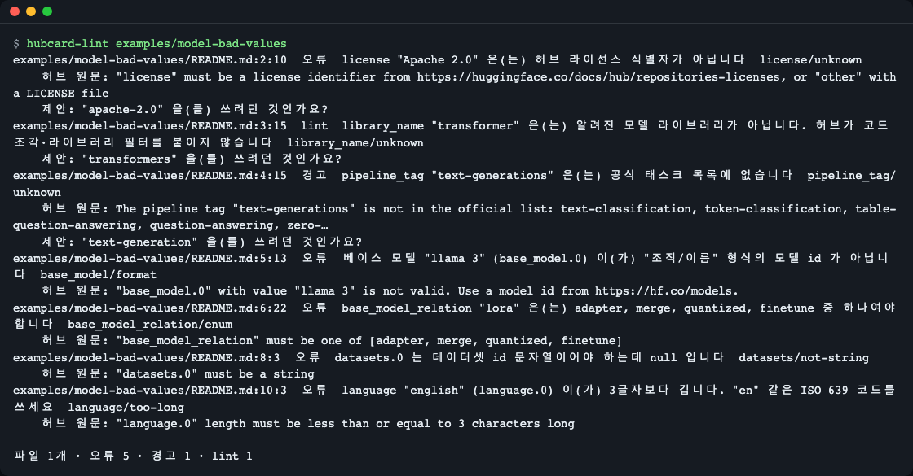
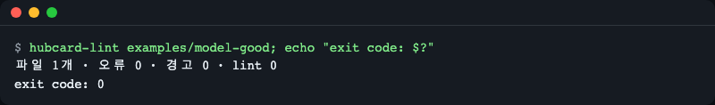
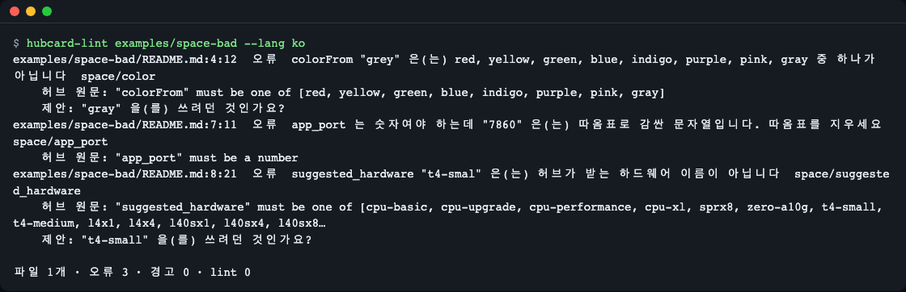
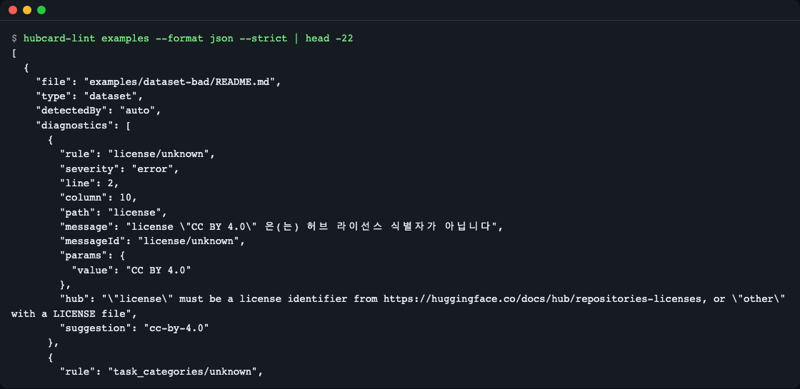
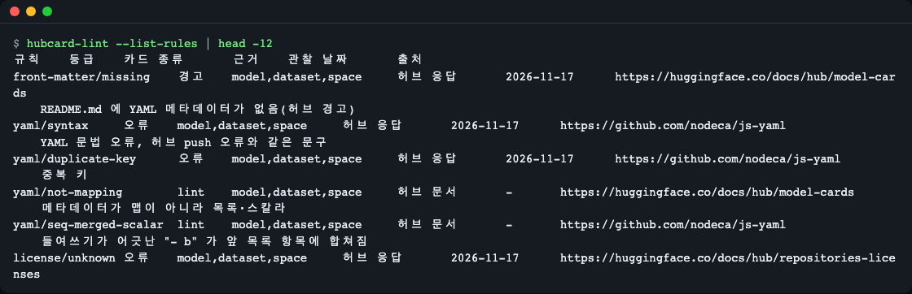
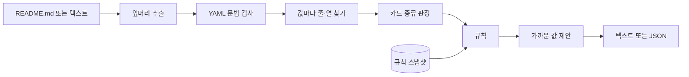

# hubcard-lint

[English](README.md) | **한국어**

Hugging Face 허브 `README.md` 카드(모델·데이터셋·Space) 맨 위 YAML 메타데이터를 인터넷 없이 검사하는 비공식 린터입니다. 문제를 한 번에 모두 알려 주고, 파일 기준 줄:열, 허브가 내는 오류 문구 그대로, 고칠 값 제안을 함께 보여 줍니다. push 거절이나 `YAML Metadata Warning` 배너를 `git push` 뒤가 아니라 commit 단계에서 미리 봅니다.


*예제 카드 한 장을 검사한 결과: 오류 5개, 경고 1개, lint 1개. 각 항목에 허브 원문(`허브 원문:`)과 제안(`제안:`)이 붙습니다.*

## 이런 분께

- 파인튜닝 모델·LoRA 어댑터·데이터셋·Space 를 허브에 올리면서 push 전에 카드 실수를 잡고 싶은 분.
- 학습 파이프라인이 카드를 자동으로 쓰고(예: 트레이너가 만드는 `datasets: - null`) CI 에서 잘못된 카드를 막고 싶은 분.
- 인터넷이 없거나 방화벽 안이라 허브에 카드 검증을 요청할 수 없는 분.

## 왜 필요한가

카드 맨 위 메타데이터는 push 할 때 허브가 검사합니다. 흔한 결과:

- push 가 거절됩니다. 예: `license: Apache 2.0` 은 `"license" must be a license identifier`.
- push 는 되지만 저장소 페이지에 `YAML Metadata Warning` 이 뜹니다. 예: 목록에 없는 `pipeline_tag`.
- `colorFrom: grey` 나 `app_port: "7860"` 처럼 허브가 기대하는 형태가 아니라서 Space 가 실패하거나 이상하게 보입니다.

`huggingface_hub` 의 `RepoCard.validate()` 는 네트워크로 허브에 물어보므로 오프라인에서는 쓸 수 없습니다. 일반 YAML 린터는 문법만 보고 허브 필드를 모릅니다. hubcard-lint 는 규칙과 목록(태스크·라이브러리·라이선스·Space 설정)을 로컬 스냅샷으로 들고 있습니다.

출국 전에 집에서 돌려 보는 점검표라고 생각하면 됩니다. 공항 카운터(허브)도 같은 점검표를 쓰지만, 카운터 앞에 서기 전에 문제를 찾습니다.

## 설치

[Node.js](https://nodejs.org/) 22 이상(예: `brew install node`, 리눅스는 배포판 패키지가 22 보다 낮을 수 있으니 nodejs.org 설치 프로그램)과 git 이 필요합니다.

```bash
git clone https://github.com/LeeGyeongPil/hubcard-lint
cd hubcard-lint
npm install
```

`npm install` 이 `dist/` 로 빌드합니다. `node dist/cli.js <경로>` 로 실행하거나 `npm link` 로 `hubcard-lint` 를 PATH 에 올립니다.

패키지가 npm 레지스트리에 게시된 뒤에는 `npx hubcard-lint <경로>` 또는 `npm install -g hubcard-lint` 도 됩니다. 묶은 tarball(`npm pack` 후 `npm install -g ./hubcard-lint-0.1.0.tgz`) 설치는 확인했고 동작합니다.

## 빠르게 시작하기

레포에 들어 있는 예제 카드 7개를 검사합니다. 아래 명령은 영어 출력을 위해 `HUBCARD_LINT_LANG=en` 을 붙였습니다. 안 붙이면 로캘을 따릅니다([화면 언어](#화면-언어) 참고). 한국어로 보려면 `ko` 로 바꾸거나 `--lang ko` 를 쓰세요.

```bash
HUBCARD_LINT_LANG=en npm start
```

출력 마지막 줄이 요약입니다.

```text
7 files · 13 errors · 3 warnings · 4 lint
```

카드 한 장을 검사하고 결과를 읽어 봅니다.

```bash
HUBCARD_LINT_LANG=en node dist/cli.js examples/model-bad-values
```

항목 하나가 한 줄입니다: `파일:줄:열  등급  설명  규칙-id`. 아래 줄은 허브 문구(`hub:`)와 가장 가까운 올바른 값(`fix:`)입니다. 줄·열은 파일 기준입니다. 오류가 있어서 종료 코드는 1 입니다. 카드를 고치고 나면:


*깨끗한 카드: 항목 0개, 종료 코드 0.*

## 사용법

```text
hubcard-lint [경로...] [옵션]
```

| 옵션 | 하는 일 | 예 |
|---|---|---|
| `paths` | `.md` 파일 또는 폴더(하위 `README.md` 를 모두 찾고 `node_modules`·`.git` 은 건너뜀). 기본값 `./README.md` | `hubcard-lint models/` |
| `--type auto\|model\|dataset\|space` | 카드 종류. `auto` 는 필드로 추정(`sdk`·`app_file` → space, `task_categories`·`configs` → dataset, 그 밖 → model) | `--type space` |
| `--format text\|json` | 사람이 읽는 출력 또는 JSON | `--format json` |
| `--strict` | 경고·lint 도 종료 코드 1 | `--strict` |
| `--exit-zero` | 항상 종료 코드 0(보고서·데모용) | `--exit-zero` |
| `--quiet` | 오류만 출력 | `--quiet` |
| `--lang en\|ko` | 출력 언어 | `--lang ko` |
| `--list-rules` | 규칙을 등급·출처·관찰 날짜와 함께 나열 | |
| `--version` | 도구 버전과 들어 있는 규칙 스냅샷 | |

종료 코드: `0` 오류 없음, `1` 오류 있음(`--strict` 면 모든 항목), `2` 사용 오류(모르는 옵션, 경로 없음).

등급:

- **error(오류)**: 시도해 보니 허브가 이 문제로 push 를 거절함(2026-11-17 관찰).
- **warning(경고)**: 허브가 받아 주지만 `YAML Metadata Warning` 을 보여 줌.
- **lint**: 허브는 받아 주지만 공개 문서와 어긋나거나, 필터·코드 스니펫·Space 빌드에서 빠지게 만듦.

### Space 검사

```bash
node dist/cli.js examples/space-bad --lang ko
```


*Space 설정: `colorFrom: grey`, 따옴표로 감싼 `app_port`, 철자가 틀린 `suggested_hardware`.*

### CI 에서 쓰기(JSON 출력)

```bash
node dist/cli.js examples --format json --strict --lang ko
```


*JSON 보고서의 첫 부분: 파일마다 객체 하나, 안에 `diagnostics` 배열.*

진단 항목은 `rule`, `severity`, `line`, `column`, `path`, `message`, `messageId`, `params` 와, 해당될 때 `hub`, `suggestion` 을 가집니다. CI 에서는 `npx hubcard-lint out/ --strict`(게시 후) 또는 체크아웃에서 `node dist/cli.js out/ --strict` 를 실행하면 되고, 0 이 아닌 종료 코드가 작업을 실패시킵니다.

### pre-commit 으로 쓰기

`.pre-commit-config.yaml` 에 훅을 추가합니다.

```yaml
repos:
  - repo: https://github.com/LeeGyeongPil/hubcard-lint
    rev: v0.1.0
    hooks:
      - id: hubcard-lint
```

바뀐 `README.md` 마다 훅이 돌고 오류가 있으면 commit 이 멈춥니다. pre-commit 은 TypeScript 빌드 없이 Git 체크아웃에서 훅을 설치하기 때문에 이 레포는 `dist/` 를 일부러 커밋합니다. 훅은 `pre-commit try-repo` 로 로컬에서 확인했고, `rev: v0.1.0` 태그는 첫 릴리스 공개 뒤에 생깁니다.

### 라이브러리로 쓰기

```js
import { lintCard, formatText } from "hubcard-lint";

const card = `---
license: Apache 2.0
library_name: transformers
pipeline_tag: text-generation
---
# my-model
`;

const result = lintCard(card, { type: "model", file: "generated/README.md" });
for (const d of result.diagnostics) {
  console.log(d.rule, d.severity, d.line, d.column, d.suggestion);
}
process.stdout.write(formatText([result], { lang: "en" }));
```

전체 예제는 `examples/api.mjs` 이고 `node examples/api.mjs` 의 출력은 다음과 같습니다.

```text
{"rule":"license/unknown","severity":"error","line":2,"column":10,"suggestion":"apache-2.0"}
generated/README.md:2:10  error  license "Apache 2.0" is not a Hub license identifier  license/unknown
    hub: "license" must be a license identifier from https://huggingface.co/docs/hub/repositories-licenses, or "other" with a LICENSE file
    fix: did you mean "apache-2.0"?

1 file · 1 error · 0 warnings · 0 lint
errors: 1
```

내보내는 것: `lintCard`, `lintFile`, `formatText`, `formatJson`, `RULES`, `SNAPSHOT_INFO`, 타입, `HubcardLintError`. 카드 내용 문제는 진단으로 돌려주고, 잘못된 옵션(`E_BAD_OPTION`)이나 읽을 수 없는 파일(`E_READ`)만 예외를 던집니다.

### 규칙

```bash
node dist/cli.js --list-rules --lang ko
```


*모든 규칙이 어떻게 알게 됐는지(실제 허브 응답, 공개 문서, 패키지)를 밝힙니다.*

설명이 있는 전체 목록은 [docs/rules.ko.md](docs/rules.ko.md) 에 있습니다.

## 설정

설정 파일도 네트워크 접근도 없습니다. 선택 환경 변수 하나만 있습니다.

| 변수 | 기본값 | 뜻 |
|---|---|---|
| `HUBCARD_LINT_LANG` | 로캘에 따름 | `en` 또는 `ko`, `--lang` 이 없을 때 사용 |

### 화면 언어

출력(도움말·설명·요약·사용 오류)은 영어와 한국어를 지원합니다. 우선순위: `--lang` > `HUBCARD_LINT_LANG` > `LC_ALL` > `LC_MESSAGES` > `LANG`. 값이 `ko` 로 시작하면 한국어, 그 밖이거나 없으면 영어입니다. 허브 원문(`hub:`·`허브 원문:` 줄)은 두 언어 모두 영어 그대로입니다. 라이브러리: `lintCard(text, { lang: "ko" })`, `formatText(results, { lang: "ko" })`.

## 동작 원리



1. 앞머리는 맨 위 `--- … ---` 블록입니다. BOM·앞 빈 줄·CRLF 는 허브처럼 허용합니다. 블록이 없으면 `front-matter/missing` 경고가 나옵니다.
2. 문법은 js-yaml 로 검사하고, 그 문구가 허브가 보여 주는 문구입니다(`bad indentation of a sequence entry (4:15)`). 허브는 블록 안 첫 줄부터 세므로 보고서에는 파일 기준 줄도 함께 적습니다.
3. 값은 일반 데이터로 읽고, 위치는 소스 위치를 보존하는 두 번째 파서(`yaml`)에서 찾습니다. 두 파서가 일부 오류의 줄을 다르게 보고하기 때문에 각자 더 잘하는 일을 나눕니다.
4. 카드 종류가 어떤 규칙을 돌릴지 정합니다. 규칙은 `@huggingface/tasks` 0.22.16 과 허브 문서에서 2026-11-17 에 만든 목록 스냅샷(태스크 57개·라이브러리 296개·라이선스 83개·Space 색과 하드웨어)을 씁니다.
5. 값이 틀리면 가장 가까운 올바른 값을 제안합니다. 힌트일 뿐 자동으로 고치지 않습니다.

### 스냅샷을 최신으로 유지하는 방법

`hubcard-lint --version` 은 스냅샷 버전과 날짜를 보여 줍니다. `node scripts/refresh-snapshot.mjs --check` 는 설치된 `@huggingface/tasks` 와 스냅샷을 비교해 차이를 출력합니다.

한계:

- 허브 서버 쪽 스키마는 공개돼 있지 않습니다. 2026-11-17 실제 응답에서 본 문제만 `error`·`warning` 이고 나머지는 `lint` 입니다.
- 모델·데이터셋 id 가 실제로 있는지, `app_file`·`LICENSE` 파일이 있는지, 마크다운 본문, `.eval_results/*.yaml` 은 검사하지 않습니다.
- 라이선스 식별자는 대소문자를 구분해 비교합니다(`MIT` 는 `mit` 제안과 함께 보고). 허브가 대소문자를 어떻게 다루는지는 관찰하지 못했습니다.
- 아주 짧은 값에 대한 제안은 엉뚱할 수 있습니다.

## 언제 쓰나

- 잘 맞는 곳: 허브에 `git push` 하기 전, pre-commit, CI 에서 네트워크·토큰 없이 하는 점검.
- 허브 클라이언트가 아닙니다. id 존재 여부처럼 허브가 필요한 점검은 공식 [`huggingface_hub`](https://huggingface.co/docs/huggingface_hub) 라이브러리를 보세요.
- 다른 파일의 순수 YAML 문법은 [yamllint](https://yamllint.readthedocs.io/) 같은 일반 YAML 린터를 쓰세요.

## 자주 겪는 문제

| 증상 | 원인 | 해결 |
|---|---|---|
| 출력이 한국어로 나옴 | 로캘이 `ko` 로 시작함 | `--lang en` 을 붙이거나 `HUBCARD_LINT_LANG=en` 설정 |
| `Cannot find package 'yaml'` | 의존성이 설치되지 않음(예: 폴더를 `npm install -g .` 한 경우) | 체크아웃에서 `npm install`, 또는 묶은 tarball 로 설치 |
| `path not found`, 종료 코드 2 | 경로가 없음 | 경로 확인. 폴더는 하위에 `README.md` 가 있어야 함 |
| 항목에 `hub:` 줄이 없음 | 관찰한 허브 문구만 인용하고 `lint` 항목에는 없음 | 정상 동작 |
| `npm warn install-scripts …` | npm 11 이 설치 스크립트 승인을 물음 | 체크아웃에서는 무시해도 됨(빌드는 이미 실행됨) |

## 개발

```bash
npm install
npm test
```

`npm test` 는 빌드하고, 테스트 타입을 검사하고, 오프라인으로 125개 테스트를 약 5초에 돌립니다. 버그·제안은 이슈로 남겨 주세요. 변경 기록은 [CHANGELOG.md](CHANGELOG.md).

## 라이선스

MIT. 데이터 출처는 [NOTICE](NOTICE) 에 있습니다: `@huggingface/tasks` 패키지(MIT)와 Hugging Face 허브 문서. hubcard-lint 는 독립 프로젝트이며 Hugging Face 와 관련이 없습니다.

## 더 알아보기

- 모델 카드: https://huggingface.co/docs/hub/model-cards (2026-11-17 확인)
- 라이선스: https://huggingface.co/docs/hub/repositories-licenses (2026-11-17 확인)
- Spaces 설정: https://huggingface.co/docs/hub/spaces-config-reference (2026-11-17 확인)
- `@huggingface/tasks`: https://github.com/huggingface/huggingface.js/tree/main/packages/tasks (2026-11-17 확인)
