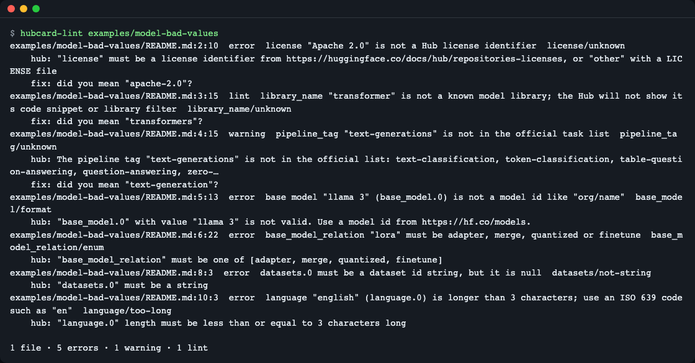
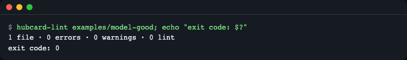
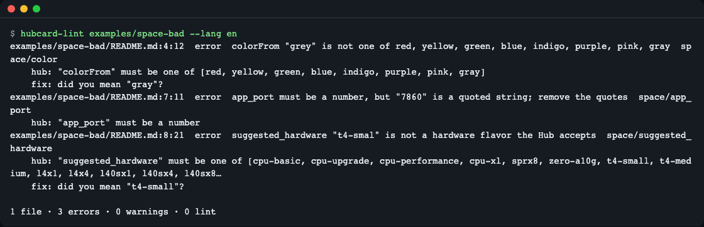
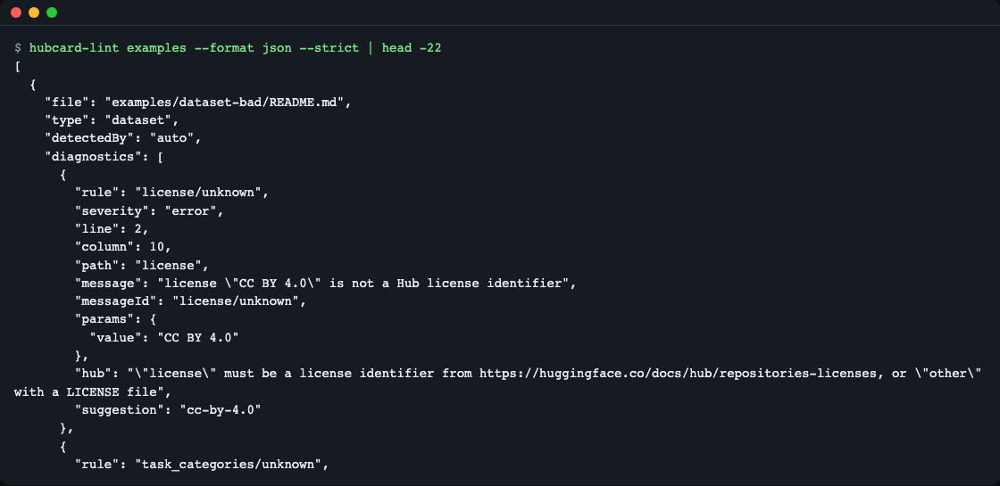
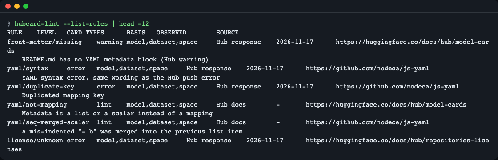
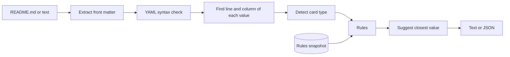

# hubcard-lint

**English** | [한국어](README.ko.md)

An unofficial, offline linter for the YAML metadata at the top of Hugging Face Hub `README.md` cards (models, datasets and Spaces). It reports every problem at once, with the file line and column, the Hub's own error wording and a suggested fix, so you see push rejections and `YAML Metadata Warning` banners at commit time instead of after `git push`.


*One run on an example card: five errors, one warning and one lint finding, each with `hub:` (what the Hub says) and `fix:` (a suggested value).*

## Who is it for

- You push fine-tuned models, LoRA adapters, datasets or Spaces to the Hub and want to catch card mistakes before the push.
- Your training pipeline writes the card automatically (for example a `datasets: - null` entry from a trainer) and CI should fail on a bad card.
- You work offline or behind a firewall, where asking the Hub to validate a card is not possible.

## Why

The metadata block of a card is checked by the Hub when you push. Typical results:

- The push is rejected, for example `"license" must be a license identifier` for `license: Apache 2.0`.
- The push works but the repo page shows a `YAML Metadata Warning`, for example for an unknown `pipeline_tag`.
- A Space fails or looks wrong because `colorFrom: grey` or `app_port: "7860"` is not what the Hub expects.

`huggingface_hub`'s `RepoCard.validate()` asks the Hub over the network, so it does not help offline. General YAML linters check syntax only and do not know Hub fields. hubcard-lint carries the rules and the lists (tasks, libraries, licenses, Space settings) as a local snapshot.

Think of it as the check-in list you run at home before leaving for the airport. The counter (the Hub) uses the same list, but you find the problem before you are standing at the counter.

## Install

You need [Node.js](https://nodejs.org/) 22 or newer (for example `brew install node`; on Linux use the installer from nodejs.org, because the distro package can be older than 22) and git.

```bash
git clone https://github.com/LeeGyeongPil/hubcard-lint
cd hubcard-lint
npm install
```

`npm install` builds the tool into `dist/`. Run it with `node dist/cli.js <path>`, or put `hubcard-lint` on your PATH with `npm link`.

Other ways, once the package is published to the npm registry: `npx hubcard-lint <path>` or `npm install -g hubcard-lint`. Installing a packed tarball (`npm pack`, then `npm install -g ./hubcard-lint-0.1.0.tgz`) was checked and works.

## Quick start

Lint the seven example cards that ship with the repo. The commands below set `HUBCARD_LINT_LANG=en` for English output; without it the language follows your locale (see [Language](#language)):

```bash
HUBCARD_LINT_LANG=en npm start
```

The last line of the output is the summary:

```text
7 files · 13 errors · 3 warnings · 4 lint
```

Then lint one card and read the result:

```bash
HUBCARD_LINT_LANG=en node dist/cli.js examples/model-bad-values
```

Each finding is one line: `file:line:column  level  message  rule-id`. The lines below it are the Hub's wording (`hub:`) and the closest valid value (`fix:`). The line and column point into your file. The command exits with code 1 because there are errors. After you fix the card:


*A clean card: zero findings and exit code 0.*

## Usage

```text
hubcard-lint [paths...] [options]
```

| Option | What it does | Example |
|---|---|---|
| `paths` | `.md` files, or folders (all `README.md` files below are collected, `node_modules` and `.git` are skipped). Default: `./README.md` | `hubcard-lint models/` |
| `--type auto\|model\|dataset\|space` | Card type. `auto` guesses from the fields (`sdk`, `app_file` → space; `task_categories`, `configs` → dataset; otherwise model) | `--type space` |
| `--format text\|json` | Human-readable or JSON output | `--format json` |
| `--strict` | Exit 1 on warnings and lint findings too | `--strict` |
| `--exit-zero` | Always exit 0 (reports, demos) | `--exit-zero` |
| `--quiet` | Print errors only | `--quiet` |
| `--lang en\|ko` | Output language | `--lang ko` |
| `--list-rules` | List rules with level, source and observation date | |
| `--version` | Tool version and the rules snapshot it contains | |

Exit codes: `0` no errors, `1` errors (or any finding with `--strict`), `2` usage error (unknown option, path not found).

Levels:

- **error**: the Hub rejected a push with this problem when it was tried (observed 2026-11-17).
- **warning**: the Hub accepts the card but shows a `YAML Metadata Warning`.
- **lint**: the Hub accepts the card, but it contradicts the public docs or drops the repo from filters, code snippets or Space builds.

### Check a Space

```bash
node dist/cli.js examples/space-bad --lang en
```


*Space settings: `colorFrom: grey`, a quoted `app_port` and a misspelled `suggested_hardware`.*

### Use in CI (JSON output)

```bash
node dist/cli.js examples --format json --strict --lang en
```


*The first lines of the JSON report: one object per file, with a `diagnostics` array.*

Each diagnostic has `rule`, `severity`, `line`, `column`, `path`, `message`, `messageId`, `params` and, when relevant, `hub` and `suggestion`. In a CI job, run `npx hubcard-lint out/ --strict` (after the package is published) or `node dist/cli.js out/ --strict` from a checkout; the non-zero exit code fails the job.

### Use with pre-commit

Add the hook to `.pre-commit-config.yaml`:

```yaml
repos:
  - repo: https://github.com/LeeGyeongPil/hubcard-lint
    rev: v0.1.0
    hooks:
      - id: hubcard-lint
```

The hook runs on every changed `README.md` and stops the commit when there is an error. The repository commits `dist/` on purpose, because pre-commit installs hooks from the Git checkout without running the TypeScript build. The hook was checked locally with `pre-commit try-repo`; the `rev: v0.1.0` tag exists once the first release is published.

### Use as a library

```js
import { lintCard, formatText } from "hubcard-lint";

const card = `---
license: Apache 2.0
library_name: transformers
pipeline_tag: text-generation
---
# my-model
`;

const result = lintCard(card, { type: "model", file: "generated/README.md" });
for (const d of result.diagnostics) {
  console.log(d.rule, d.severity, d.line, d.column, d.suggestion);
}
process.stdout.write(formatText([result], { lang: "en" }));
```

The full example is `examples/api.mjs`; `node examples/api.mjs` prints:

```text
{"rule":"license/unknown","severity":"error","line":2,"column":10,"suggestion":"apache-2.0"}
generated/README.md:2:10  error  license "Apache 2.0" is not a Hub license identifier  license/unknown
    hub: "license" must be a license identifier from https://huggingface.co/docs/hub/repositories-licenses, or "other" with a LICENSE file
    fix: did you mean "apache-2.0"?

1 file · 1 error · 0 warnings · 0 lint
errors: 1
```

Exports: `lintCard`, `lintFile`, `formatText`, `formatJson`, `RULES`, `SNAPSHOT_INFO`, the types and `HubcardLintError`. Card content problems are returned as diagnostics; only a bad option (`E_BAD_OPTION`) or an unreadable file (`E_READ`) throws.

### Rules

```bash
node dist/cli.js --list-rules --lang en
```


*Every rule states how it was learned: from a real Hub response, the public docs or a package.*

The full list with explanations is in [docs/rules.md](docs/rules.md).

## Configuration

There are no config files and no network access. One optional environment variable:

| Variable | Default | Meaning |
|---|---|---|
| `HUBCARD_LINT_LANG` | from your locale | `en` or `ko`, used when `--lang` is not given |

### Language

The output (help, messages, summary, usage errors) is available in English and Korean. Order of precedence: `--lang` > `HUBCARD_LINT_LANG` > `LC_ALL` > `LC_MESSAGES` > `LANG`. A value starting with `ko` selects Korean; anything else, or nothing, selects English. The Hub's own wording (`hub:` lines) stays English in both languages. Library: `lintCard(text, { lang: "ko" })` and `formatText(results, { lang: "ko" })`.

## How it works



1. The front matter is the `--- … ---` block at the top. A BOM, leading blank lines and CRLF line endings are accepted, as on the Hub. No block gives a `front-matter/missing` warning.
2. Syntax is checked with js-yaml, whose messages are the ones the Hub shows (`bad indentation of a sequence entry (4:15)`). The Hub counts from the first line inside the block, so the report also gives the file line.
3. Values are read as plain data, and their positions come from a second parser (`yaml`) that keeps source locations. The two parsers disagree on some error lines, so each does the job it is better at.
4. The card type decides which rules run. The rules use a snapshot of the Hub lists (57 tasks, 296 libraries, 83 licenses, Space colors and hardware) taken from `@huggingface/tasks` 0.22.16 and the Hub docs on 2026-11-17.
5. For wrong values, the closest valid value is suggested. It is a hint, never applied automatically.

### How it stays in sync

`hubcard-lint --version` prints the snapshot version and date. `node scripts/refresh-snapshot.mjs --check` compares the snapshot with the installed `@huggingface/tasks` and prints the difference.

Limits:

- The Hub's server-side schema is not public. Only problems seen in real responses on 2026-11-17 are `error` or `warning`; the rest is `lint`.
- It does not check whether a model or dataset id exists, whether `app_file` or `LICENSE` exist, the Markdown body, or `.eval_results/*.yaml`.
- License identifiers are compared case-sensitively (`MIT` is reported with the suggestion `mit`); how the Hub treats case was not observed.
- Suggestions for very short values can be wrong.

## When to use it

- Good fit: a check before `git push` to the Hub, in pre-commit, or in CI, with no network and no token.
- It is not a Hub client. For checks that need the Hub, such as whether an id exists, see the official [`huggingface_hub`](https://huggingface.co/docs/huggingface_hub) library.
- For plain YAML syntax in other files, use a general YAML linter such as [yamllint](https://yamllint.readthedocs.io/).

## Troubleshooting

| Symptom | Cause | Fix |
|---|---|---|
| Output is in Korean | Your locale starts with `ko` | Add `--lang en` or set `HUBCARD_LINT_LANG=en` |
| `Cannot find package 'yaml'` | Dependencies are not installed (for example after `npm install -g .` of a folder) | Run `npm install` in the checkout, or install from a packed tarball |
| `path not found`, exit code 2 | The path does not exist | Check the path; a folder needs a `README.md` below it |
| No `hub:` line on a finding | Only observed Hub messages are quoted; `lint` findings have none | This is expected |
| `npm warn install-scripts …` | npm 11 asks to approve install scripts | Safe to ignore for the checkout; the build already ran |

## Development

```bash
npm install
npm test
```

`npm test` builds, type-checks the tests and runs 125 tests in about 5 seconds, offline. Bug reports and suggestions are welcome as issues. Changes are listed in [CHANGELOG.md](CHANGELOG.md).

## License

MIT. Data sources are listed in [NOTICE](NOTICE): the `@huggingface/tasks` package (MIT) and the Hugging Face Hub documentation. hubcard-lint is an independent project and is not affiliated with Hugging Face.

## References

- Model cards: https://huggingface.co/docs/hub/model-cards (checked 2026-11-17)
- Licenses: https://huggingface.co/docs/hub/repositories-licenses (checked 2026-11-17)
- Spaces config: https://huggingface.co/docs/hub/spaces-config-reference (checked 2026-11-17)
- `@huggingface/tasks`: https://github.com/huggingface/huggingface.js/tree/main/packages/tasks (checked 2026-11-17)
